# Tic Tac Toe — Architecture Documentation

> **Purpose:** Detailed implementation guide based on the uploaded *Tic Tac Toe Product Requirement Document (PRD), Version 1.0*.
>
> **Important distinction:** The PRD specifies the game requirements and high-level technical constraints. CQRS, Cortex.Mediator, Clean Architecture project boundaries, and Serilog are explained below as a **recommended implementation design**. They should only be described as implemented technologies after they have actually been added to the solution.

---

## 1. Project Overview

**Tic Tac Toe** is a browser-based game built with ASP.NET Core MVC, C#, HTML, CSS, JavaScript, and ASP.NET Core SignalR.

It supports three game modes:

1. **Local two-player:** Two people play in the same browser.
2. **Player versus AI:** A human plays against a Minimax-based AI.
3. **Online multiplayer:** Two players play in real time through SignalR rooms.

The game does not require a database. Game sessions, rooms, player slots, and temporary reconnection information are held in application memory.

### 1.1 Technology and responsibility

| Technology | Responsibility |
|---|---|
| ASP.NET Core MVC | HTTP endpoints, page delivery, dependency injection, application hosting |
| C# | Game rules, application use cases, room management, AI |
| HTML/CSS/JavaScript | Browser UI and board interaction |
| ASP.NET Core SignalR | Real-time online game communication |
| In-memory collections | Temporary rooms and active game sessions |
| Minimax | AI move selection |
| NUnit | Automated tests |
| Moq | Test doubles for dependencies |
| Shouldly | Readable assertions |
| Cortex.Mediator | Recommended mediator implementation for commands and queries |
| Serilog | Recommended structured logging implementation |
| Monster ASP.NET | Intended hosting target |

**No database is required by the PRD.** Do not add Entity Framework Core, SQL Server, repositories, or Unit of Work merely to make the architecture look more complex. In-memory state is an intentional requirement, with the hosting/restart limitation explained later.

---

## 2. Recommended Solution Architecture

A lightweight Clean Architecture-inspired structure keeps the game rules independent from MVC, SignalR, and hosting details.

### 2.1 Four logical layers

| Layer | Main responsibility | Examples |
|---|---|---|
| Presentation | Receives browser/HTTP/SignalR input and returns output | MVC controllers, Razor views, SignalR Hub |
| Application | Coordinates use cases | Commands, queries, handlers, DTOs, validators, application services |
| Domain | Owns game rules and state transitions | GameSession, Board, Player, win/draw rules, game enums |
| Infrastructure | Implements technical concerns | In-memory stores, timers, logging configuration, connection/user mapping |

### 2.2 Dependency direction

The central rule is that **Domain must not depend on Application, Infrastructure, MVC, or SignalR**. Application uses Domain. Presentation and Infrastructure depend on Application contracts where appropriate.

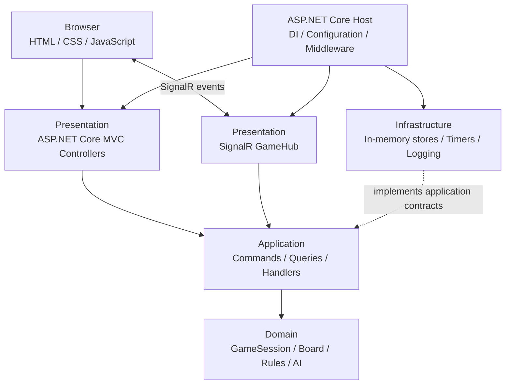

The dotted relationship means Infrastructure supplies implementations for abstractions used by the Application layer. Domain remains independent.

### 2.3 Suggested project structure

```text
TicTacToe/
│
├── src/
│   ├── TicTacToe.Web/
│   │   ├── Controllers/
│   │   ├── Hubs/
│   │   │   └── GameHub.cs
│   │   ├── Views/
│   │   ├── wwwroot/
│   │   │   ├── css/
│   │   │   ├── js/
│   │   │   └── lib/
│   │   ├── Extensions/
│   │   ├── Middleware/
│   │   ├── Program.cs
│   │   └── appsettings.json
│   │
│   ├── TicTacToe.Application/
│   │   ├── Abstractions/
│   │   │   ├── IGameSessionStore.cs
│   │   │   ├── IRoomStore.cs
│   │   │   └── IGameNotifier.cs
│   │   ├── Features/
│   │   │   ├── Games/
│   │   │   │   ├── Commands/
│   │   │   │   ├── Queries/
│   │   │   │   └── DTOs/
│   │   │   └── Rooms/
│   │   │       ├── Commands/
│   │   │       ├── Queries/
│   │   │       └── DTOs/
│   │   ├── Behaviors/
│   │   └── DependencyInjection.cs
│   │
│   ├── TicTacToe.Domain/
│   │   ├── Entities/
│   │   │   ├── GameSession.cs
│   │   │   ├── Board.cs
│   │   │   ├── Player.cs
│   │   │   └── GameRoom.cs
│   │   ├── Enums/
│   │   ├── Services/
│   │   │   ├── GameRules.cs
│   │   │   └── MinimaxAi.cs
│   │   └── Exceptions/
│   │
│   └── TicTacToe.Infrastructure/
│       ├── Persistence/
│       │   ├── InMemoryGameSessionStore.cs
│       │   └── InMemoryRoomStore.cs
│       ├── Realtime/
│       │   └── SignalRGameNotifier.cs
│       ├── Services/
│       │   └── ReconnectionManager.cs
│       ├── Logging/
│       └── DependencyInjection.cs
│
└── tests/
    ├── TicTacToe.Domain.UnitTests/
    ├── TicTacToe.Application.UnitTests/
    └── TicTacToe.Web.IntegrationTests/
```

This is a suggested organization, not a claim that these folders already exist. Keep the solution smaller if the implementation does not need every abstraction.

---

## 3. Domain Design — The Actual Game Rules

The Domain layer contains the rules that must remain correct regardless of whether a move comes from local play, AI, or an online player.

### 3.1 GameSession

`GameSession` represents one match. According to the PRD, it tracks:

- Unique session ID.
- Game mode.
- Board.
- Current turn.
- Game status.
- Result.
- Move count.

Illustrative model:

```csharp
public sealed class GameSession
{
    public Guid Id { get; init; } = Guid.NewGuid();
    public GameMode Mode { get; init; }
    public Board Board { get; private set; } = new();
    public PlayerSymbol CurrentTurn { get; private set; } = PlayerSymbol.X;
    public GameStatus Status { get; private set; } = GameStatus.InProgress;
    public GameResult? Result { get; private set; }
    public int MoveCount { get; private set; }

    // State-changing methods should validate the transition
    // rather than allowing arbitrary external property changes.
}
```

Prefer controlled state changes over public setters in the production domain model. The snippet illustrates the data described by the PRD; exact constructors and methods depend on your implementation.

### 3.2 Board

A board contains nine cells. `null` means empty.

```csharp
public sealed class Board
{
    public const int CellCount = 9;

    private readonly PlayerSymbol?[] _cells = new PlayerSymbol?[CellCount];

    public PlayerSymbol? GetCell(int index) => _cells[index];

    public bool IsEmpty(int index) =>
        index >= 0 &&
        index < CellCount &&
        _cells[index] is null;
}
```

Board indexes:

```text
 0 | 1 | 2
---+---+---
 3 | 4 | 5
---+---+---
 6 | 7 | 8
```

### 3.3 Enums

```csharp
public enum PlayerSymbol
{
    X,
    O
}

public enum GameStatus
{
    WaitingForPlayers,
    InProgress,
    Finished
}

public enum GameResult
{
    PlayerXWins,
    PlayerOWins,
    Draw,
    PlayerXWinsByForfeit,
    PlayerOWinsByForfeit
}

public enum GameMode
{
    Local,
    VsAI,
    Online
}
```

### 3.4 Winning combinations

There are exactly eight winning combinations:

```csharp
private static readonly int[][] WinningCombinations =
{
    new[] { 0, 1, 2 },
    new[] { 3, 4, 5 },
    new[] { 6, 7, 8 },
    new[] { 0, 3, 6 },
    new[] { 1, 4, 7 },
    new[] { 2, 5, 8 },
    new[] { 0, 4, 8 },
    new[] { 2, 4, 6 }
};
```

### 3.5 Move validation and state transition

The browser should submit only the selected cell index. The server determines the player symbol and validates the move. The client must not be trusted to submit the official board, winner, next player, player identity, or result.

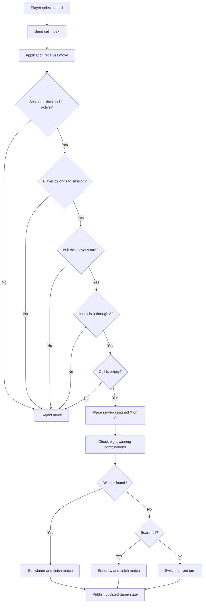

If any validation fails, the board must remain unchanged.

### 3.6 Winner and draw detection

After each valid move:

1. Check each of the eight winning combinations.
2. A win exists if all three cells in a combination contain the same non-null symbol.
3. Store the winning combination so the UI can highlight it.
4. If there is no winner and all nine cells are occupied, declare a draw.
5. Otherwise switch the current turn.

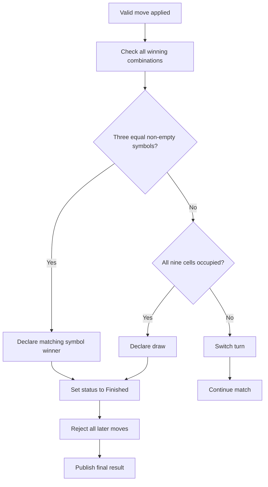

---

## 4. Clean Architecture — Why Separate the Layers?

Clean Architecture is an organization approach. It is not a framework or a NuGet package.

Its main goal is to keep business rules independent from delivery mechanisms and technical details.

### 4.1 Presentation layer

Responsibilities:

- Serve MVC pages.
- Receive HTTP requests.
- Receive SignalR messages.
- Perform basic request-shape validation.
- Obtain the caller's identity/room membership from trusted server-side context.
- Send commands or queries to Application.
- Return HTTP responses or publish real-time notifications.

Examples:

- `HomeController`
- `GameController`
- `GameHub`

A controller or Hub should not implement the winning algorithm or Minimax search itself.

### 4.2 Application layer

Responsibilities:

- Represent application use cases.
- Coordinate domain operations.
- Load the relevant in-memory session through an abstraction.
- Call domain rules.
- Save the updated session through an abstraction.
- Return a result/DTO.
- Coordinate notifications where appropriate.

Examples:

- `CreateGameCommand`
- `MakeMoveCommand`
- `GetGameStateQuery`
- `CreateRoomCommand`
- `JoinRoomCommand`
- `RequestRematchCommand`

### 4.3 Domain layer

Responsibilities:

- Define game entities and enums.
- Enforce turn and board rules.
- Detect wins and draws.
- Represent valid state transitions.
- Calculate the AI's best move if Minimax is placed in the domain.

The Domain layer should not reference `Hub`, `HubCallerContext`, MVC controllers, SignalR connection IDs, or Serilog.

### 4.4 Infrastructure layer

Responsibilities:

- Store active sessions and rooms in memory.
- Implement application storage abstractions.
- Coordinate reconnection deadlines.
- Implement SignalR notification abstractions.
- Configure external technical services such as logging.

The in-memory implementation is an adapter. The Application layer should depend on an interface such as `IGameSessionStore`, not directly on `ConcurrentDictionary`.

---

## 5. CQRS — Command Query Responsibility Segregation

CQRS means **Command Query Responsibility Segregation**. It separates operations that change state from operations that read state.

It does not require two databases. In this project, both commands and queries can use the same in-memory session store.

### 5.1 Command

A command expresses an intention to change something.

Examples:

| Command | Responsibility |
|---|---|
| `CreateGameCommand` | Create a new game session |
| `MakeMoveCommand` | Validate and apply a player's move |
| `CreateRoomCommand` | Create an online room |
| `JoinRoomCommand` | Add a second player to a room |
| `DisconnectPlayerCommand` | Mark a player disconnected |
| `ReconnectPlayerCommand` | Restore an authorized player connection |
| `RequestRematchCommand` | Reset a completed match after the required requests |

A command handler performs the use case. A command should not be used simply to retrieve data.

### 5.2 Query

A query reads data and should not change game state.

Examples:

| Query | Responsibility |
|---|---|
| `GetGameStateQuery` | Read the current board, turn, status, and result |
| `GetRoomQuery` | Read room occupancy and status |
| `GetAvailableMovesQuery` | Return empty cell indexes |
| `GetPlayerStatusQuery` | Read player connection status |

### 5.3 Command versus query flow

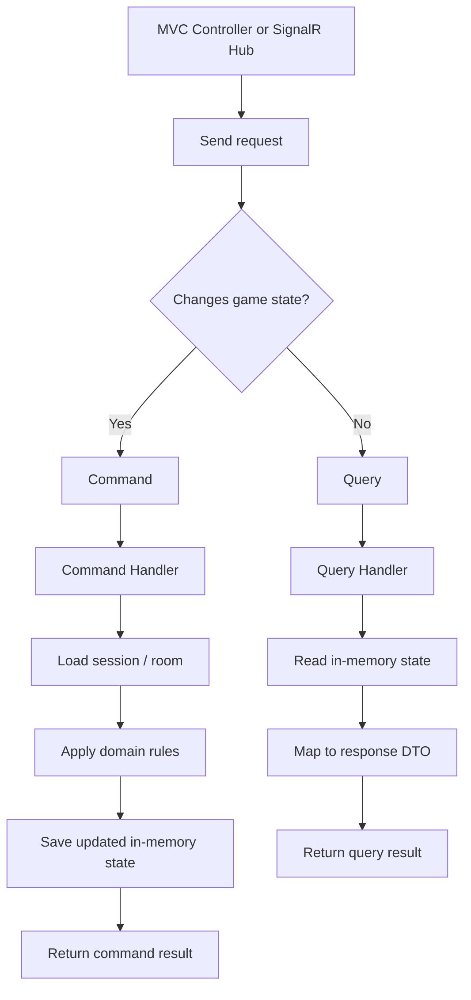

### 5.4 Why CQRS is useful here

- A move changes state; reading the board does not.
- Validation and state transitions stay in command handlers/domain methods.
- Read responses can use DTOs designed for the UI.
- Each use case is easier to unit test.
- MVC and SignalR can invoke the same application use cases.

### 5.5 What CQRS does not mean in this project

- It does not mean you need separate read and write databases.
- It does not mean every property needs its own command.
- It does not mean you need event sourcing.
- It does not mean you need microservices.
- It does not mean you need a repository and Unit of Work for an in-memory game.

---

## 6. Mediator Pattern and Cortex.Mediator

### 6.1 What is the Mediator Pattern?

The Mediator Pattern reduces direct dependencies between objects by routing requests through a mediator.

Without a mediator, a controller may directly depend on several application services. With a mediator, the controller sends a request and the matching handler executes it.

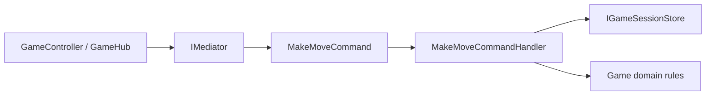

The controller does not need to know how the handler loads a session, validates a turn, or updates the board.

### 6.2 What is Cortex.Mediator?

Cortex.Mediator is a .NET mediator library that can be used to dispatch requests to handlers. In this proposed design, it provides the request/handler dispatch mechanism for CQRS.

Conceptually:

- A command is a request to change state.
- A command handler contains the use-case implementation.
- A query is a request to read data.
- A query handler returns the requested data.
- The mediator locates and invokes the appropriate handler.

The exact interfaces, registration method, and package version must match the Cortex.Mediator version installed in your solution. Verify the package documentation before copying API-specific code.

### 6.3 Example command shape

The following is conceptual C# showing the responsibility split. Adapt request/handler interfaces to your installed Cortex.Mediator version.

```csharp
public sealed record MakeMoveCommand(
    Guid GameId,
    string PlayerId,
    int CellIndex);
```

The handler's job is to execute the use case:

```csharp
public sealed class MakeMoveCommandHandler
{
    private readonly IGameSessionStore _store;

    public MakeMoveCommandHandler(IGameSessionStore store)
    {
        _store = store;
    }

    // Conceptual handler flow:
    // 1. Load the session.
    // 2. Validate session and player.
    // 3. Validate turn and cell.
    // 4. Apply the domain move.
    // 5. Save the updated session.
    // 6. Return the result.
}
```

### 6.4 Example query shape

```csharp
public sealed record GetGameStateQuery(Guid GameId);
```

Its handler reads the session and returns a DTO. It should not advance the turn, change the board, or trigger a move.

### 6.5 End-to-end request flow

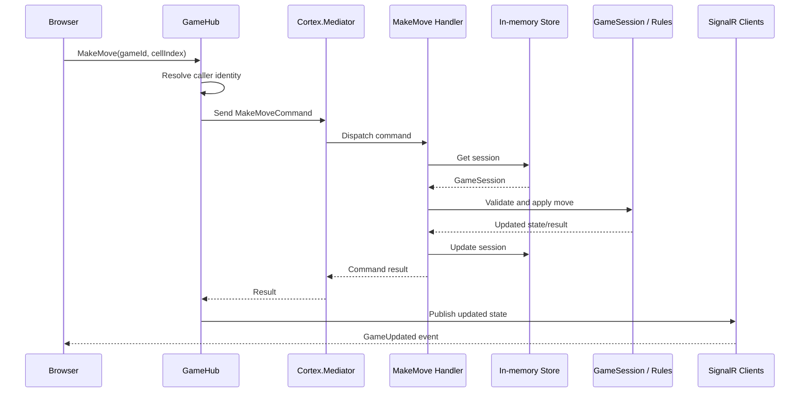

### 6.6 Should every operation use the mediator?

Not necessarily. Use it for application use cases where it improves separation and consistency. Do not add mediator dispatch to trivial internal methods such as `Board.IsEmpty(index)` or `GameRules.HasWinner(board)`.

---

## 7. GameService and Application Use Cases

The PRD refers to `GameService` as the point through which moves are processed. With CQRS, the responsibilities can be organized as follows:

- The **MakeMove handler** coordinates the application use case.
- The **domain model/rules** enforce the game rules.
- The **session store** retrieves and stores active state.
- The **AI service** chooses a candidate move, then submits it through the same move use case.
- The **SignalR Hub** handles connection-facing communication and notifications.

This prevents the local, AI, and online modes from implementing separate versions of the game rules.

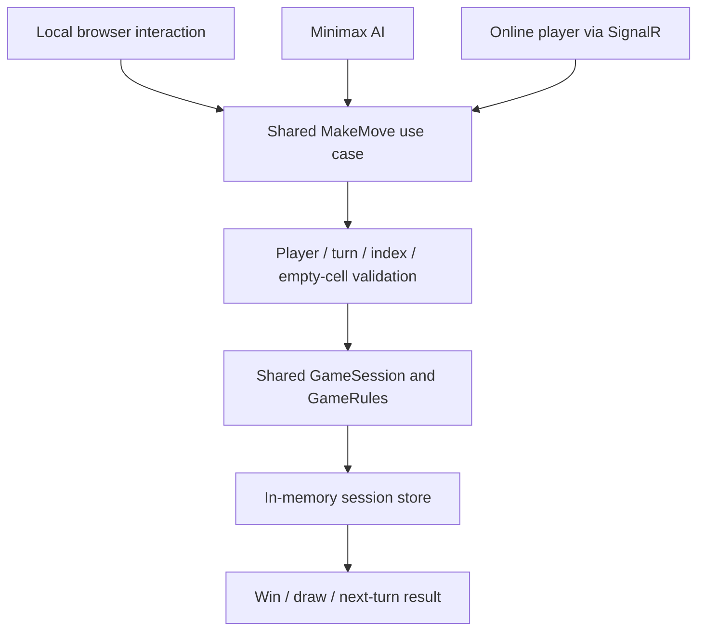

**Important:** In local mode, the application may run the rules in browser JavaScript if that is how the product is implemented. However, the PRD's shared-engine objective is best met by keeping the authoritative rules in one reusable implementation. For online mode, the server must always be authoritative.

---

## 8. Three Game Modes

### 8.1 Local two-player mode

Two players share one browser. The PRD states that this mode does not require SignalR or a database.

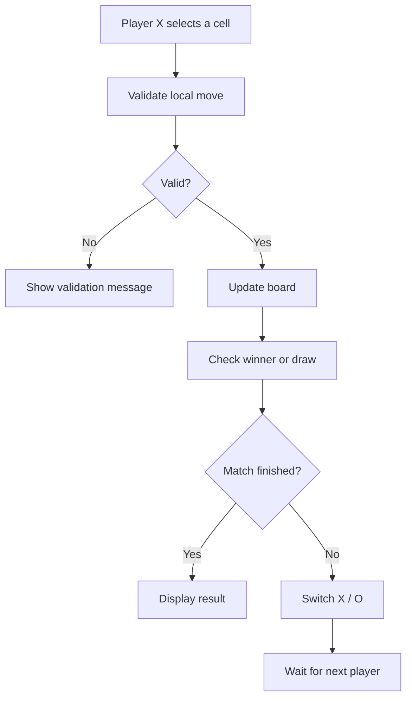

### 8.2 Player versus AI

The human plays as X and the AI plays as O by default.

The AI should not directly edit the board. It should select a cell and submit it through the normal move-processing path.

#### Minimax explanation

Minimax explores possible future board states:

- The AI is the maximizing player.
- The human is the minimizing player.
- AI win: `+10`.
- Draw: `0`.
- AI loss: `-10`.
- Search-depth adjustment can prefer faster wins and slower losses.

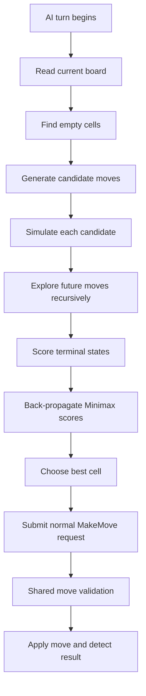

### 8.3 Online multiplayer mode

Two players connect through SignalR.

The PRD requires:

- Create a room.
- Generate a room code.
- Share an invitation URL.
- Join an existing room.
- Assign X and O.
- Play in real time.
- Request a rematch.
- Support exactly two player slots.

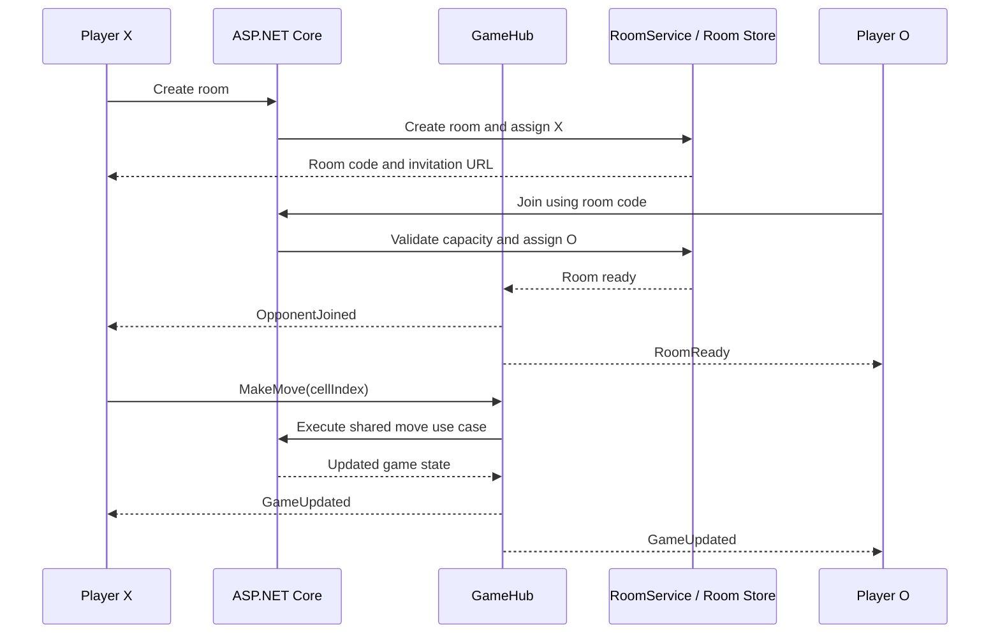

---

## 9. SignalR — Real-Time Communication

SignalR allows the server to send updates to connected browsers without requiring the browser to repeatedly poll an HTTP endpoint.

### 9.1 SignalR components

| Component | Responsibility |
|---|---|
| SignalR Hub | Entry point for client-to-server real-time calls |
| Hub method | A method the browser can invoke |
| Client event | A named event the server sends to browsers |
| Connection ID | Identifies a current SignalR connection |
| Group | A collection of connections, commonly one per game room |
| Hub context | Server-side API for sending messages to clients |

### 9.2 Hub responsibilities

A Hub can expose operations such as:

- `CreateRoom`
- `JoinRoom`
- `MakeMove`
- `RequestRematch`
- `Reconnect`

The Hub should not own the board rules. It should resolve the caller's identity, dispatch the appropriate application use case, and send the result.

### 9.3 Example events

| Direction | Name | Meaning |
|---|---|---|
| Browser → server | `CreateRoom` | Create an online room |
| Browser → server | `JoinRoom` | Join an existing room |
| Browser → server | `MakeMove` | Submit a cell index |
| Browser → server | `RequestRematch` | Request a new match |
| Server → browser | `RoomCreated` | Room creation succeeded |
| Server → browser | `RoomReady` | Both player slots are occupied |
| Server → browser | `GameUpdated` | Board/turn/status changed |
| Server → browser | `PlayerDisconnected` | Opponent disconnected |
| Server → browser | `PlayerReconnected` | Opponent reconnected |
| Server → browser | `GameFinished` | Win, draw, or forfeit |

These are suggested event names; the PRD does not mandate exact method or event identifiers.

### 9.4 SignalR move flow

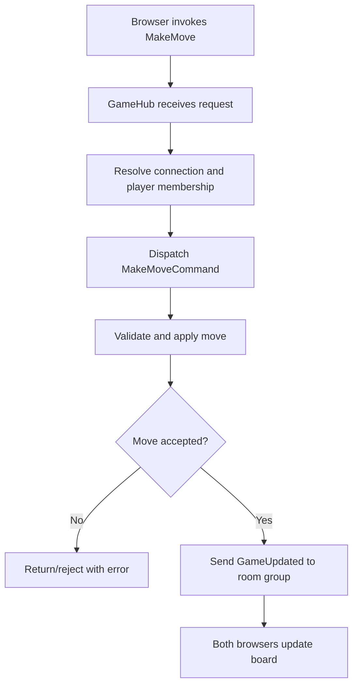

---

## 10. In-Memory Room and Session Management

The PRD explicitly requires in-memory storage.

### 10.1 What is stored?

A room/session may contain:

- Room code and room ID.
- Current `GameSession`.
- X and O player slots.
- Current SignalR connection IDs.
- Player connection status.
- Temporary reconnect-token information.
- Reconnection deadline.
- Room lifecycle status.

Do not store passwords or unnecessary personal information in room state.

### 10.2 Store abstractions

The Application layer can define interfaces:

```csharp
public interface IGameSessionStore
{
    Task<GameSession?> GetAsync(Guid gameId);
    Task AddAsync(GameSession session);
    Task UpdateAsync(GameSession session);
    Task RemoveAsync(Guid gameId);
}

public interface IRoomStore
{
    Task<GameRoom?> GetByCodeAsync(string roomCode);
    Task AddAsync(GameRoom room);
    Task UpdateAsync(GameRoom room);
    Task RemoveAsync(string roomCode);
}
```

These signatures are illustrative. For a small in-memory game, synchronous methods may be sufficient; do not add artificial async operations unless needed by the implementation.

Infrastructure implements the interfaces using in-memory collections.

### 10.3 ConcurrentDictionary

`ConcurrentDictionary` provides thread-safe individual dictionary operations such as lookup, add, and remove.

It does **not** make a multi-step operation on a `GameSession` automatically atomic or thread-safe.

### 10.4 SemaphoreSlim

A per-game `SemaphoreSlim` can serialize state-changing operations for the same game.

Conceptual flow:

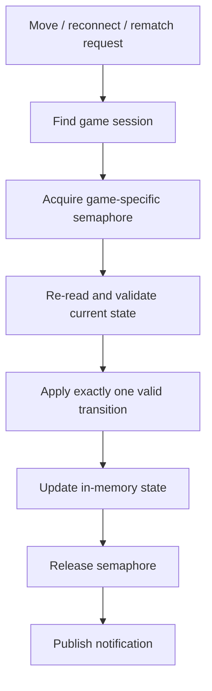

Always release the semaphore in a `finally` block. Ensure timeout, reconnect, move, and rematch operations use a consistent synchronization strategy.

---

## 11. Disconnect and Reconnection

The PRD specifies a 30-second reconnection window.

### 11.1 Disconnect flow

1. SignalR detects the disconnected connection.
2. The server marks the corresponding player slot disconnected.
3. The opponent is notified.
4. A 30-second deadline begins.
5. The board and match state remain in memory.
6. The original player may reconnect with a temporary token.
7. If the deadline expires first, the connected opponent wins by forfeit.

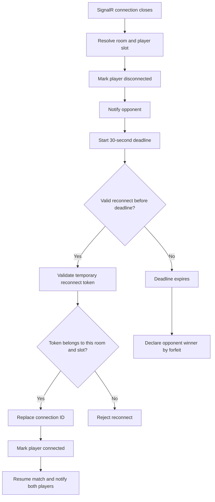

### 11.2 Reconnection token

The PRD requires the token to be:

- Cryptographically random.
- Temporary and private to the player.
- Stored in browser session storage.
- Validated by the server.
- Associated with a specific room and player slot.
- Invalidated after match completion.

The room code is not a reconnect token. A room code is an invitation identifier, not proof that a caller owns a player slot.

### 11.3 Race condition

A reconnect can arrive at almost the same time as the timeout. Protect both operations with the same per-game synchronization mechanism. Only one outcome should win: successful reconnection or forfeit.

---

## 12. Logging — ILogger and Serilog

Logging records what the application is doing and helps diagnose failures. It is not the same as returning error messages to the browser.

### 12.1 Microsoft ILogger

ASP.NET Core provides `ILogger<T>` through dependency injection.

Example:

```csharp
public sealed class MakeMoveCommandHandler
{
    private readonly ILogger<MakeMoveCommandHandler> _logger;

    public MakeMoveCommandHandler(
        ILogger<MakeMoveCommandHandler> logger)
    {
        _logger = logger;
    }

    // Use the logger when processing a command.
}
```

`ILogger<T>` is the application-facing logging abstraction. Application classes can depend on it without depending directly on Serilog.

### 12.2 What is Serilog?

Serilog is a structured logging library for .NET. It can receive log events through the Microsoft logging pipeline and write them to configured destinations called **sinks**.

Examples of sinks:

- Console.
- File.
- Seq or another supported log server.

The actual sinks depend on the packages and configuration installed in the project.

### 12.3 ILogger versus Serilog

| `ILogger<T>` | Serilog |
|---|---|
| Logging abstraction supplied by Microsoft.Extensions.Logging | Concrete structured logging provider |
| Used by application classes | Configured as the logging implementation/provider |
| Keeps application code provider-independent | Adds structured properties, enrichers, and sinks |
| `LogInformation`, `LogWarning`, `LogError` | Writes events to configured destinations |

Recommended dependency direction:

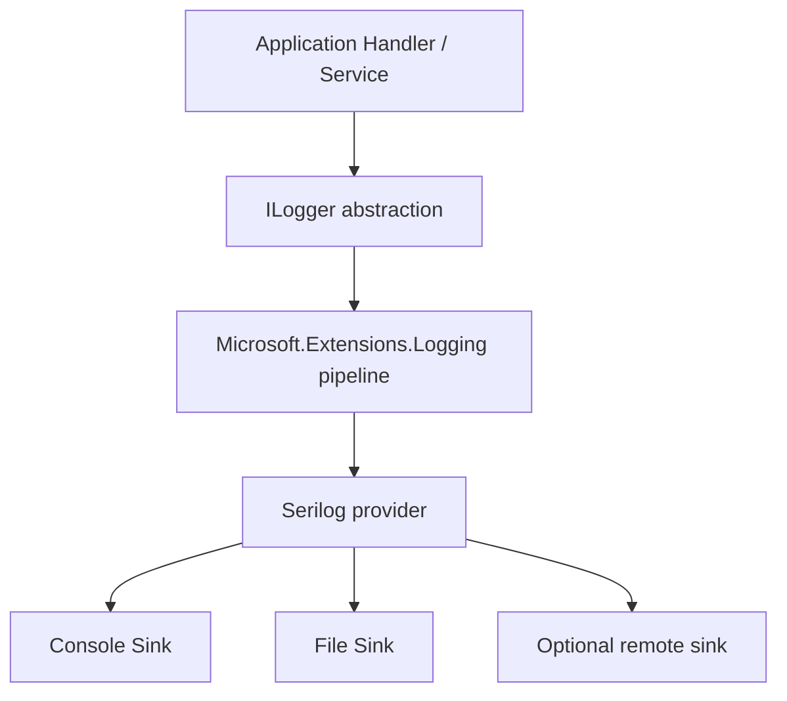

### 12.4 Log levels

| Level | Use |
|---|---|
| Verbose | Very detailed diagnostic information |
| Debug | Development diagnostics |
| Information | Normal significant application events |
| Warning | Unexpected condition that the application handled |
| Error | Operation failed |
| Fatal | Application cannot continue |

Examples of useful events:

- Room created.
- Player joined a room.
- Move accepted.
- Move rejected.
- Game completed.
- Player disconnected.
- Player reconnected.
- Reconnection deadline expired.
- Unexpected exception.

### 12.5 Structured logging

Prefer named properties rather than building a long interpolated string.

```csharp
_logger.LogInformation(
    "Move accepted for game {GameId} by player {PlayerId} at cell {CellIndex}",
    gameId,
    playerId,
    cellIndex);
```

The values are stored as structured properties, making them easier to filter and search.

For a rejected move:

```csharp
_logger.LogWarning(
    "Move rejected for game {GameId}. Reason: {Reason}",
    gameId,
    rejectionReason);
```

For an exception:

```csharp
_logger.LogError(
    exception,
    "Unexpected error while processing move for game {GameId}",
    gameId);
```

Do not log reconnect tokens, passwords, authentication secrets, or other sensitive values.

### 12.6 Example Serilog host configuration

This is an example configuration, not a statement that Serilog is already installed. Add the appropriate Serilog hosting and sink packages before using it.

```csharp
using Serilog;

var builder = WebApplication.CreateBuilder(args);

builder.Host.UseSerilog((context, services, configuration) =>
{
    configuration
        .ReadFrom.Configuration(context.Configuration)
        .ReadFrom.Services(services)
        .Enrich.FromLogContext()
        .WriteTo.Console();
});

builder.Services.AddControllersWithViews();
builder.Services.AddSignalR();

var app = builder.Build();

app.MapDefaultControllerRoute();
app.MapHub<GameHub>("/gameHub");

app.Run();
```

For file output, configure a file sink only after confirming the hosting plan permits writing to the chosen directory and that the directory is writable. On shared hosting, verify log persistence and rotation behavior.

### 12.7 Logging flow during a move

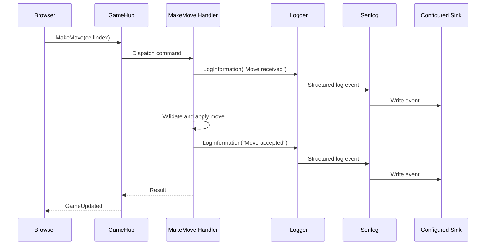

---

## 13. Dependency Injection

Dependency Injection (DI) supplies a class's dependencies from the ASP.NET Core service container instead of making the class construct those dependencies itself.

For example, a handler receives `IGameSessionStore` and `ILogger<MakeMoveCommandHandler>` through its constructor.

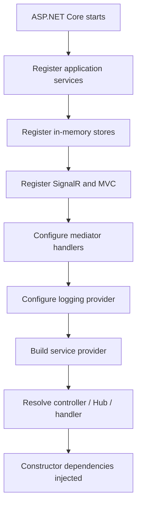

Example registrations (adapt names and mediator registration to the actual project):

```csharp
builder.Services.AddControllersWithViews();
builder.Services.AddSignalR();

builder.Services.AddSingleton<IGameSessionStore, InMemoryGameSessionStore>();
builder.Services.AddSingleton<IRoomStore, InMemoryRoomStore>();

// Register Application handlers / Cortex.Mediator according
// to the installed package version and its documented API.
```

**Lifetime consideration:** In-memory stores are commonly singleton services because all requests in one application process must see the same active games. Do not register the room store as scoped if that would create isolated state per request.

A singleton store must be thread-safe. Its contained session objects still need synchronization when multiple requests can mutate them.

---

## 14. Security and Trust Boundaries

The browser is not authoritative. A modified browser can send requests that the normal UI would never create.

The server must:

- Resolve the caller from the validated connection and room membership.
- Confirm that the player belongs to the requested room.
- Confirm that it is the player's turn.
- Validate cell index from 0 through 8.
- Confirm that the cell is empty.
- Reject moves after completion.
- Validate reconnect tokens against the correct room and slot.
- Avoid trusting client-submitted board state, symbol, winner, or next turn.

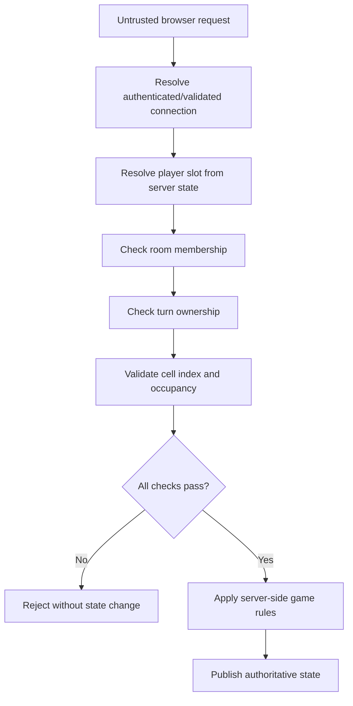

The PRD describes a validated player identity/slot. The exact authentication approach is not specified, so do not assume that the game requires a full account-registration system.

---

## 15. Error Handling

Use expected validation outcomes for normal game conditions and exceptions for unexpected failures.

Examples of expected rejections:

- Game not found.
- Game already finished.
- Player not in room.
- Not the player's turn.
- Invalid cell index.
- Cell already occupied.
- Room is full.
- Invalid reconnect token.
- Rematch request not allowed yet.

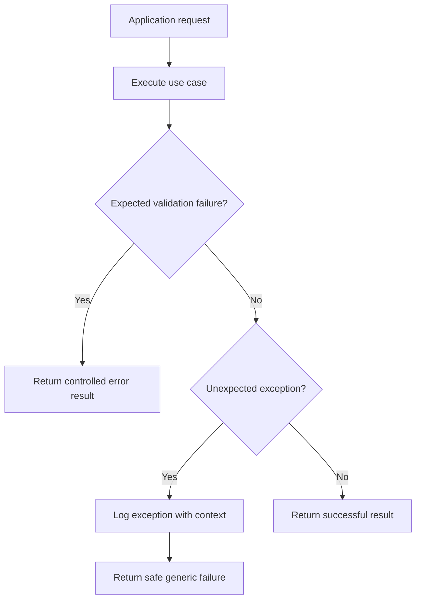

Never send stack traces, internal exception details, reconnect tokens, or private server data to the browser.

---

## 16. Testing Strategy

The PRD calls for NUnit, Moq, and Shouldly, with unit and integration coverage.

### 16.1 Domain unit tests

Test the rules without MVC or SignalR:

- Empty board initialization.
- X starts first.
- Valid move placement.
- Invalid index rejection.
- Occupied cell rejection.
- Turn alternation.
- All eight winning combinations.
- Draw detection.
- No moves after game completion.
- Rematch resets board and move count.

### 16.2 Application unit tests

Test use cases and their dependencies:

- Make-move handler loads the right session.
- A non-member cannot move.
- Wrong-turn move is rejected.
- Invalid move does not update the store.
- Accepted move updates the store.
- Get-game-state query returns expected DTO.
- Room creation assigns X.
- Second player receives O.
- Room capacity is enforced.

Use Moq to mock abstractions such as `IGameSessionStore`. Use Shouldly for readable assertions.

### 16.3 AI tests

- AI chooses only an empty cell.
- AI takes an immediate winning move.
- AI blocks an immediate human win.
- AI chooses a valid move on an empty board.
- AI never submits a move when the game is finished.

### 16.5 Testing flow

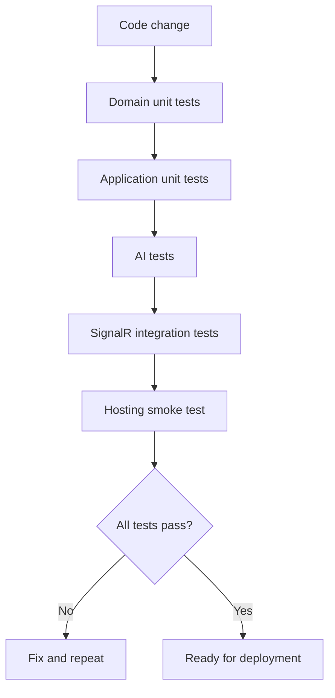

---

## 17. Deployment — Monster ASP.NET

The PRD names Monster ASP.NET as the deployment target. The actual plan must be checked for SignalR/WebSocket support and application lifecycle behavior.

### 17.1 Hosting requirements to verify

- ASP.NET Core runtime compatibility.
- WebSocket support for SignalR.
- Correct SignalR endpoint routing.
- HTTPS configuration.
- Application startup and shutdown behavior.
- Writable log directory if file logging is enabled.
- Memory and connection limits.
- Idle timeout and application-pool recycling behavior.

### 17.2 In-memory state limitation

Because active games are stored in memory:

- Application restart loses active games.
- Application recycle loses rooms and sessions.
- A second application instance has a different in-memory store.
- A reconnect cannot restore a game after the process has lost its state.

The PRD accepts in-memory storage, but this has an operational consequence. Test the actual hosting plan before relying on online multiplayer in production.

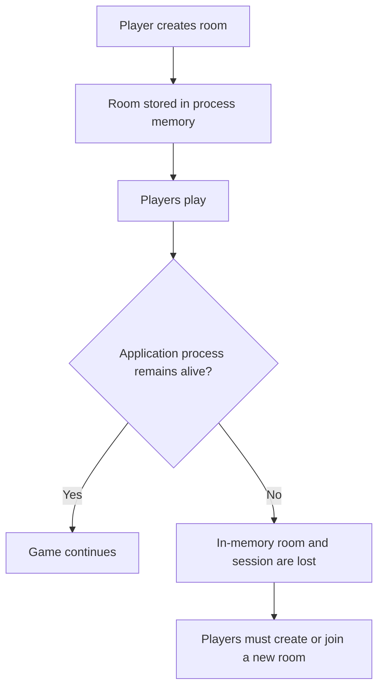

---

## 18. End-to-End System Flow

This diagram shows how the major components cooperate. Local mode does not need SignalR; online mode uses SignalR for communication. Both should follow the same game rules.

```mermaid
flowchart TD
    User["Player"]
    UI["Browser UI<br/>HTML / CSS / JavaScript"]
    MVC["ASP.NET Core MVC"]
    Hub["SignalR GameHub"]
    Mediator["Cortex.Mediator<br/>recommended request dispatcher"]
    Command["MakeMoveCommand"]
    Handler["MakeMove Handler"]
    Store["In-memory GameSession Store"]
    Domain["Domain<br/>GameSession / Board / GameRules"]
    AI["Minimax AI"]
    Logger["ILogger<T>"]
    Serilog["Serilog provider<br/>if configured"]
    Output["Console / File / configured sink"]

    User --> UI
    UI --> MVC
    UI <--> Hub
    MVC --> Mediator
    Hub --> Mediator
    AI --> Mediator
    Mediator --> Command
    Command --> Handler
    Handler <--> Store
    Handler --> Domain
    Handler --> Logger
    Logger --> Serilog
    Serilog --> Output
    Handler --> Hub
    Hub --> UI
```

---

## 19. Architecture Decisions and Important Boundaries

| Decision | Reason |
|---|---|
| No database | The PRD explicitly says database is not required |
| In-memory storage | Matches the temporary game/room lifecycle |
| One shared move-validation path | Prevents different rules for local, AI, and online play |
| Server-authoritative online game | Prevents clients from deciding turns, winners, or board state |
| CQRS | Separates state-changing operations from read operations |
| Cortex.Mediator | Recommended dispatcher for commands and queries; verify package API/version |
| SignalR | Real-time room and board updates |
| Minimax | AI decision algorithm specified by the PRD |
| Per-game synchronization | Protects state from concurrent move/reconnect/rematch operations |
| `ILogger<T>` abstraction | Keeps application code independent of a logging provider |
| Serilog | Recommended structured logging provider and sink pipeline |
| No repository/Unit of Work for a database | There is no database persistence requirement |

### 19.1 What is required versus recommended?

| Item | Status in supplied PRD |
|---|---|
| ASP.NET Core MVC | Specified |
| C# | Specified |
| HTML/CSS/JavaScript | Specified |
| SignalR | Specified |
| No database | Specified |
| In-memory storage | Specified |
| Local / AI / online modes | Specified |
| Minimax | Specified |
| 30-second reconnect window | Specified |
| `ConcurrentDictionary` | Recommended in PRD |
| `SemaphoreSlim` or equivalent per-game synchronization | Recommended in PRD |
| Clean Architecture-style separation | Implied by requested project structure/layer responsibilities; exact folder structure is an implementation choice |
| CQRS | Not explicitly required; recommended design |
| Cortex.Mediator | Not explicitly required; optional library choice |
| Serilog | Not explicitly required; optional logging provider |
| Separate read/write databases | Not required |
| Event sourcing | Not required |
| Microservices | Not required |
| EF Core / SQL Server | Not required and inconsistent with the no-database scope unless requirements change |

---

## 20. Final Engineering Principle

**One shared set of game rules. Three game modes. Nine cells. Eight winning combinations. Minimax AI. SignalR-based online play. Server-validated moves. In-memory game state. No database dependency.**

The most important implementation rule is to keep game decisions authoritative and consistent: the client requests an action, the application validates it, the Domain applies the game rules, the in-memory store retains the updated state, and SignalR publishes the result to online players.
