# Tic Tac Toe --- Agent-Driven Implementation Plan

**Document Type:** Phase-by-Phase Implementation Plan\
**Version:** 1.0\
**Based on:** Tic Tac Toe PRD v1.0 and Architecture Design\
**Backend:** ASP.NET Core MVC / C#\
**Frontend:** HTML, CSS, JavaScript\
**Real-Time Communication:** ASP.NET Core SignalR\
**Storage:** In-memory only\
**Database:** Not required\
**Deployment Target:** Monster ASP.NET

------------------------------------------------------------------------

## 1. Purpose

This document is an execution plan for an autonomous coding agent
working inside the Tic Tac Toe repository.

The agent is expected to inspect the existing repository, implement the
application phase by phase, run builds and tests, fix issues, and keep
documentation aligned with the actual code.

**The agent must do the implementation work.** The user should not be
asked to manually create files, copy code, run routine commands, or
complete implementation steps that the agent can perform in the
repository environment.

If the agent cannot perform an action because of missing permissions,
unavailable tools, missing credentials, or an external service
limitation, it must explain the exact blocker and provide the smallest
necessary user action. It must not pretend that work was completed.

## 2. Product Scope

Build a browser-based Tic Tac Toe game with three modes:

1.  **Local two-player:** Two people play on the same browser.
2.  **Player versus AI:** One person plays against a computer opponent
    using Minimax.
3.  **Online multiplayer:** Two players play in real time using SignalR
    rooms.

The game uses a 3 × 3 board and the symbols X and O. Player X starts
first. A player may select only an empty cell during their turn. Three
matching symbols in a row, column, or diagonal win. If all nine cells
are filled without a winner, the result is a draw.

The application must use one shared game-rules implementation. Online
game actions must always be validated by the server.

## 3. Non-Negotiable Agent Rules

The agent must follow these rules throughout implementation:

-   **Inspect before changing:** Read the solution, project files,
    existing conventions, and current implementation before editing.
-   **Preserve working code:** Do not replace or restructure existing
    code unnecessarily.
-   **Follow the repository:** Use the actual target framework,
    namespaces, naming conventions, and package versions found in the
    solution. Do not assume a framework version.
-   **Implement, do not merely describe:** Create and edit files,
    configure dependencies, run commands, and verify results.
-   **Work in phases:** Complete the current phase's acceptance criteria
    before moving to the next phase.
-   **Build frequently:** Run the relevant build and tests after each
    meaningful phase. Fix errors before proceeding.
-   **No database:** Do not add SQL Server, PostgreSQL, Entity Framework
    Core, migrations, or database repositories. The PRD requires
    in-memory storage.
-   **No unnecessary complexity:** Use a lightweight Clean
    Architecture-inspired structure. Do not introduce microservices,
    event sourcing, a message broker, or distributed infrastructure.
-   **One source of game rules:** Controllers, hubs, and JavaScript must
    not create separate competing implementations of authoritative game
    rules.
-   **Server authority:** For online matches, the server owns the board,
    turn, player assignment, result, and room state. Never trust
    client-supplied symbols, player identity, winner, score, or game
    status.
-   **Thread safety:** Protect shared in-memory state and serialize
    mutations to the same match.
-   **Safe errors:** Do not expose stack traces, secrets, internal
    exception details, or reconnect tokens to clients.
-   **Structured logging:** Use `ILogger<T>` throughout application
    components. Configure Serilog only if it is part of the approved
    project stack and can be configured correctly.
-   **Tests are part of implementation:** Do not mark a phase complete
    while its required tests fail.
-   **Keep documentation honest:** Do not claim a feature, package,
    test, or deployment capability exists until it is implemented and
    verified.
-   **No unnecessary user questions:** Make reasonable implementation
    decisions from the PRD. Ask only when a genuine blocker or product
    ambiguity cannot be resolved safely from the repository and
    requirements.
-   **No deployment without authorization:** Prepare deployment
    configuration and instructions, but do not publish to a live hosting
    account or use credentials unless the user explicitly authorizes
    that action.

## 4. Target Architecture

**Diagram standard:** Every visual in this document is authored in Mermaid. There are no embedded screenshots, external image files, ASCII-art diagrams, or non-Mermaid visual charts. Mermaid diagrams render directly in compatible Markdown viewers such as GitHub.

Use four logical layers. Adapt folder and project names to the existing
solution rather than forcing a new structure.

  -----------------------------------------------------------------------
  Layer                   Responsibility          Examples
  ----------------------- ----------------------- -----------------------
  Presentation            HTTP pages, browser     MVC controllers, Razor
                          interface, SignalR      views, `GameHub`,
                          endpoints               JavaScript, CSS

  Application             Coordinates use cases   Commands, queries,
                                                  handlers, DTOs,
                                                  validators, application
                                                  services

  Domain                  Owns game rules and     `GameSession`, board
                          state transitions       state, players,
                                                  win/draw detection,
                                                  game status

  Infrastructure          Implements technical    In-memory stores,
                          abstractions            connection tracking,
                                                  room cleanup, timers
  -----------------------------------------------------------------------

### 4.1 Dependency direction

-   Domain must not depend on ASP.NET Core, MVC, SignalR, Application,
    or Infrastructure.
-   Application may depend on Domain and application abstractions.
-   Infrastructure implements abstractions defined by the inner layers.
-   Presentation calls Application use cases and maps results to HTTP or
    SignalR responses.
-   The SignalR hub must not contain the game rules.

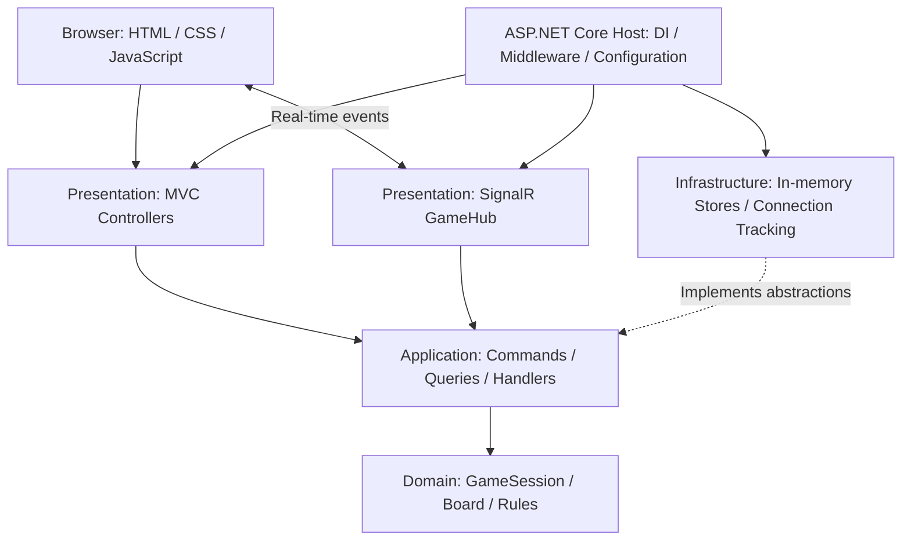

### 4.2 Suggested solution structure

Use this as a guide, not as a reason to rename an existing working
solution.

```mermaid
flowchart TD
    Root["TicTacToe Repository"]

    Root --> Src["src/"]
    Root --> Tests["tests/"]
    Root --> Docs["docs/"]
    Root --> Readme["README.md"]

    Src --> Web["TicTacToe.Web"]
    Src --> App["TicTacToe.Application"]
    Src --> Domain["TicTacToe.Domain"]
    Src --> Infra["TicTacToe.Infrastructure"]

    Web --> Controllers["Controllers/"]
    Web --> Hubs["Hubs/"]
    Web --> Views["Views/"]
    Web --> Static["wwwroot/"]
    Web --> Extensions["Extensions/"]
    Web --> Program["Program.cs"]
    Static --> Css["css/"]
    Static --> Js["js/"]
    Static --> Images["images/"]

    App --> Contracts["Contracts/"]
    App --> Features["Features/"]
    App --> DTOs["DTOs/"]
    App --> Validators["Validators/"]
    Features --> Games["Games/"]
    Features --> Rooms["Rooms/"]

    Domain --> Entities["Entities/"]
    Domain --> Enums["Enums/"]
    Domain --> Rules["Rules/"]
    Domain --> Exceptions["Exceptions/"]

    Infra --> Stores["Stores/"]
    Infra --> Services["Services/"]
    Infra --> InfraExtensions["Extensions/"]

    Tests --> DomainTests["TicTacToe.Domain.Tests"]
    Tests --> AppTests["TicTacToe.Application.Tests"]
    Tests --> IntegrationTests["TicTacToe.Integration.Tests"]

    Docs --> PRD["PRD.md"]
    Docs --> Architecture["ARCHITECTURE.md"]
    Docs --> Plan["IMPLEMENTATION_PLAN.md"]
```

Only create separate projects where they add real value and fit the
current repository. If the repository already has a valid structure,
retain it.

------------------------------------------------------------------------

# 5. Phase-by-Phase Implementation

## Phase 0 --- Repository Discovery and Baseline

### Objective

Understand the existing repository and establish a verified baseline
before making changes.

### Agent tasks

1.  Inspect the repository tree and solution file.
2.  Identify the target framework and SDK.
3.  Inspect all project references and NuGet packages.
4.  Read `Program.cs`, configuration files, controllers, views, and
    existing tests.
5.  Check whether SignalR, mediator, Serilog, and test packages are
    already installed.
6.  Identify existing naming and namespace conventions.
7.  Run the existing build and test suite.
8.  Record existing failures separately from failures introduced by the
    agent.

### Deliverables

-   Repository structure understood.
-   Baseline build result recorded.
-   Baseline test result recorded.
-   Short implementation note identifying existing code that can be
    reused.

### Acceptance criteria

-   The agent can explain the current solution structure from repository
    evidence.
-   No existing source files have been changed unnecessarily.
-   Baseline build and test results are known.
-   The agent has not added a database dependency.

------------------------------------------------------------------------

## Phase 1 --- Solution Foundation and Dependency Injection

### Objective

Establish or complete the lightweight layered solution and application
startup configuration.

### Agent tasks

1.  Create missing projects only if required by the current repository.
2.  Configure project references according to the dependency direction.
3.  Add only the packages required by the approved design.
4.  Configure dependency injection through clear extension methods where
    useful.
5.  Configure MVC routes and static files.
6.  Register SignalR services.
7.  Configure development exception handling and production exception
    handling.
8.  Configure logging through `ILogger<T>`.
9.  If Serilog is selected, configure it as the logging provider and
    verify startup and shutdown behavior.
10. Add a basic health or home endpoint if the application needs a
    startup smoke test.

### Logging guidance

Use structured message templates:

``` csharp
_logger.LogInformation(
    "Starting a new game session. GameId: {GameId}",
    gameId);
```

Do not use string interpolation for routine structured log messages.
Never log private reconnect tokens or secrets.

### Acceptance criteria

-   The solution builds.
-   MVC starts successfully.
-   SignalR services are registered.
-   Dependency injection resolves required services.
-   No database packages or database configuration have been introduced.
-   Logs are emitted without preventing application startup.

------------------------------------------------------------------------

## Phase 2 --- Domain Model and Game Rules

### Objective

Implement the complete Tic Tac Toe rules independently of MVC, SignalR,
and storage.

### Agent tasks

1.  Define the required enums, such as:
    -   `PlayerSymbol` (`X`, `O`)
    -   `GameStatus` (`Waiting`, `InProgress`, `Won`, `Draw`)
    -   `GameMode` (`Local`, `AI`, `Online`)
2.  Implement a board representation containing exactly nine cells.
3.  Implement game state containing:
    -   Game/session ID
    -   Board
    -   Current player
    -   Game status
    -   Winner, if any
    -   Move count
    -   Winning cell indexes, if any
4.  Implement the initial state with an empty board and X as the first
    player.
5.  Implement move validation:
    -   Index must be between 0 and 8.
    -   Cell must be empty.
    -   Game must still be in progress.
    -   Requested player must own the current turn.
6.  Implement move application.
7.  Implement all eight winning combinations.
8.  Implement draw detection.
9.  Prevent additional moves after a win or draw.
10. Implement a reset/rematch operation that restores an empty board and
    X's turn.

### Winning combinations

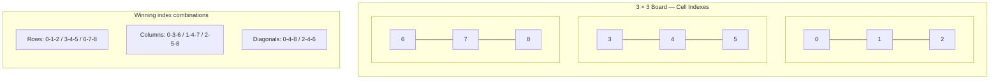

### Domain flow

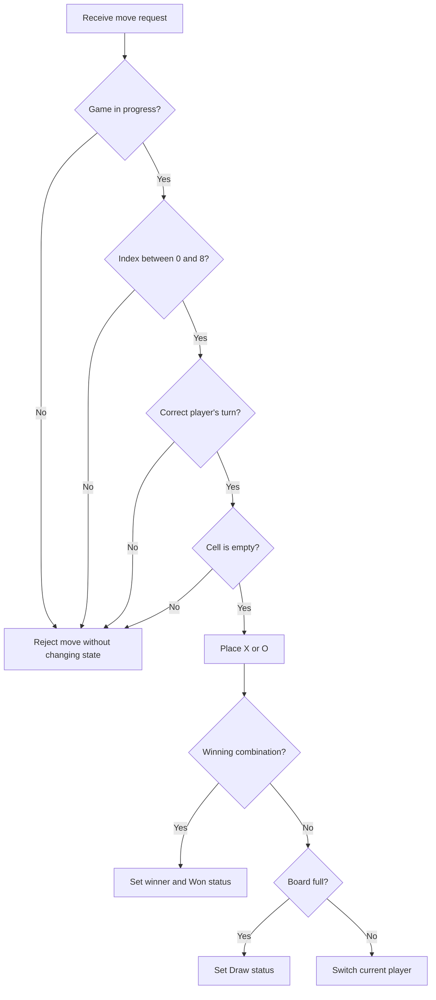

### Acceptance criteria

-   Domain rules have no dependency on ASP.NET Core or SignalR.
-   All invalid moves are rejected without mutating the board.
-   All eight win patterns work.
-   Draw detection works.
-   A finished match cannot accept another move.
-   Reset restores the exact initial state.

------------------------------------------------------------------------

## Phase 3 ---  Unit Tests

### Objective

Prove the game rules before connecting them to application or web
layers.

### Agent tasks

Create or update NUnit tests. Use Moq only when a dependency needs to be
replaced; use Shouldly for readable assertions if those packages are
part of the solution.

Test cases:

-   New board contains nine empty cells.
-   X starts first.
-   Valid X move is accepted.
-   Turn changes from X to O after a valid non-winning move.
-   Invalid index is rejected.
-   Occupied cell is rejected.
-   Wrong-turn move is rejected.
-   Each of the eight winning combinations is detected.
-   Draw is detected.
-   A completed game rejects additional moves.
-   Reset clears the board and restores X's turn.

### Acceptance criteria

-   Every listed rule has test coverage.
-   Tests are deterministic and do not depend on real time or external
    services.
-   All domain tests pass.

------------------------------------------------------------------------

## Phase 4 --- Application Use Cases and CQRS

### Objective

Expose game operations through clear application use cases so MVC and
SignalR share the same workflow.

### Agent tasks

1.  Define application contracts for game-session storage.
2.  Define command and query DTOs.
3.  Implement use cases for:
    -   Start a local game.
    -   Start an AI game.
    -   Get game state.
    -   Make a move.
    -   Reset or rematch a local game.
4.  Keep commands for state changes and queries for reads.
5.  Add validation at the application boundary where appropriate.
6.  Ensure handlers call the Domain rules rather than duplicating them.
7.  Return explicit success or failure results.
8.  Add structured logs around important operations without logging
    sensitive data.

### Suggested request flow

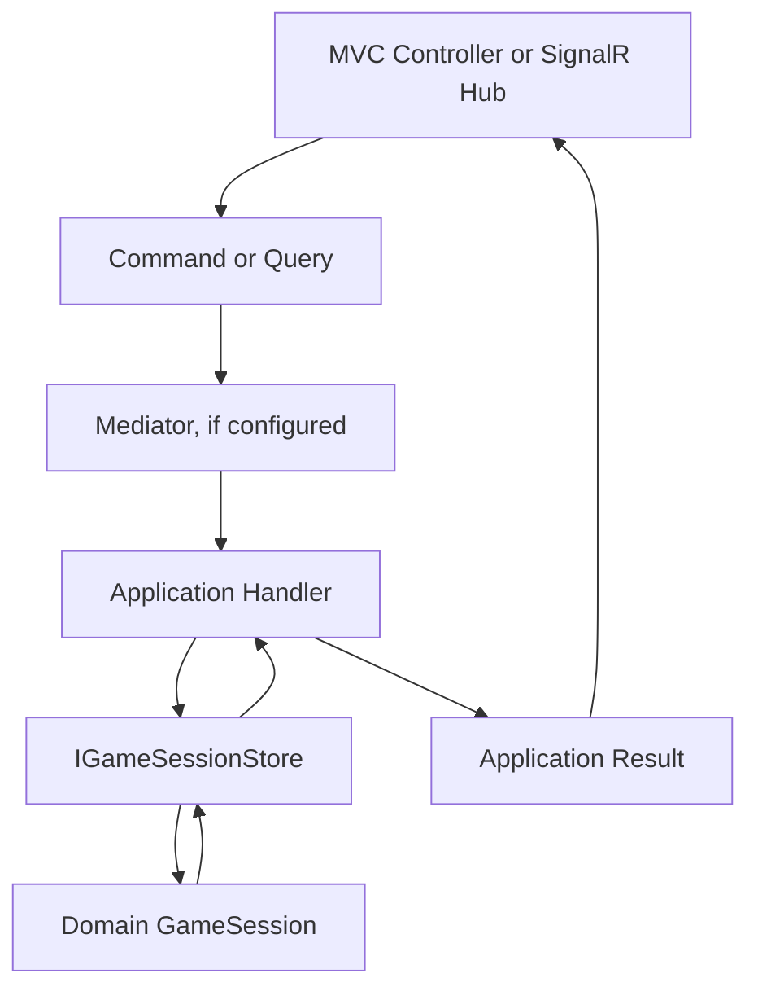

### Mediator guidance

Use Cortex.Mediator only if it is compatible with the repository's
target framework and package setup. Do not add a mediator solely for
architectural appearance. If the repository does not use a mediator,
direct application-service interfaces are acceptable.

### Acceptance criteria

-   MVC and SignalR can invoke the same application use cases.
-   The application layer does not depend on controllers or hubs.
-   Handlers do not duplicate win, draw, or turn rules.
-   Invalid operations return controlled results.
-   Relevant application tests pass.

------------------------------------------------------------------------

## Phase 5 --- In-Memory Game Session Store

### Objective

Store active games without a database.

### Agent tasks

1.  Define `IGameSessionStore` in an inner layer.
2.  Implement it in Infrastructure using a thread-safe collection such
    as `ConcurrentDictionary`.
3.  Support create, retrieve, update, and remove operations.
4.  Ensure game IDs are unique.
5.  Protect each game's mutation from concurrent requests, for example
    with a per-game `SemaphoreSlim`.
6.  Ensure locks are released in `finally` blocks.
7.  Avoid exposing mutable internal objects directly to unrelated
    callers.
8.  Define cleanup behavior for abandoned sessions where required.

### Concurrency flow

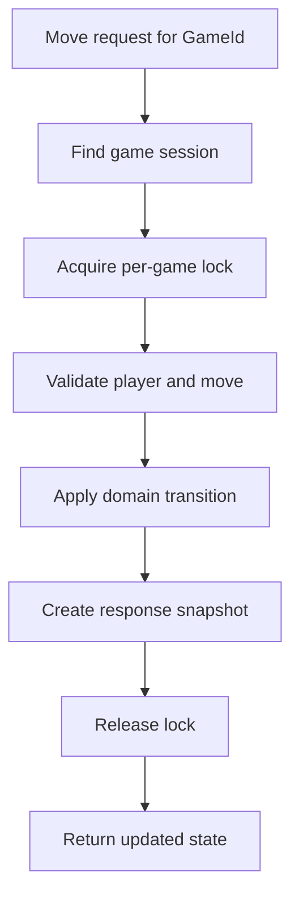

### Acceptance criteria

-   No database is used.
-   Two simultaneous requests cannot both mutate the same game as if
    they were sequential valid turns.
-   Different games can progress independently.
-   Missing or expired games return controlled errors.
-   Store tests pass.

------------------------------------------------------------------------

## Phase 6 --- Local Two-Player Mode

### Objective

Deliver a complete playable game for two people using one browser.

### Agent tasks

1.  Create or complete the home page and game-mode selection.
2.  Add the local game route/page.
3.  Render a responsive 3 × 3 board using HTML and CSS.
4.  Display the current player.
5.  Capture cell clicks and submit moves through the application
    workflow.
6.  Render X and O.
7.  Highlight the winning combination.
8.  Display win and draw messages.
9.  Disable interaction when a cell is occupied or the game has
    finished.
10. Add a restart button.
11. Support mouse, touch, and keyboard accessibility where practical.
12. Keep JavaScript focused on interaction and rendering; do not create
    a second authoritative rules engine.

### UI states

-   New game.
-   X's turn.
-   O's turn.
-   X wins.
-   O wins.
-   Draw.
-   Invalid or failed action.
-   Restarted game.

### Acceptance criteria

-   Two players can complete a game on one browser.
-   All rules are enforced.
-   The UI always reflects the application game state.
-   Restart produces a fresh board.
-   Layout works on desktop and mobile widths.

------------------------------------------------------------------------

## Phase 7 --- AI Opponent with Minimax

### Objective

Allow a human player to play against an AI opponent.

### Agent tasks

1.  Assign the human X and AI O by default.
2.  Implement Minimax in a dedicated domain or application component
    appropriate to the architecture.
3.  Evaluate terminal states:
    -   AI win: positive score.
    -   Human win: negative score.
    -   Draw: zero.
4.  Use search depth to prefer faster wins and delay unavoidable losses.
5.  Generate candidate moves only for empty cells.
6.  Never allow the AI to modify the board outside the normal
    move-processing path.
7.  Submit the selected AI move through the same application move
    workflow.
8.  Prevent duplicate AI turns while a move is being processed.
9.  Do not run an AI move after the game has ended.
10. Add deterministic tests for tactical cases.

### Minimax flow

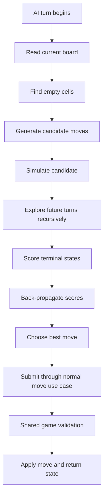

### Acceptance criteria

-   AI always chooses a currently empty cell.
-   AI takes an immediate winning move when available.
-   AI blocks an immediate human win when required.
-   AI never moves out of turn or after game completion.
-   AI cannot bypass shared game validation.
-   AI tests pass.

------------------------------------------------------------------------

## Phase 8 --- Online Room Management

### Objective

Implement room creation and joining before adding live gameplay.

### Agent tasks

1.  Define a room model with:
    -   Unique room ID.
    -   Human-readable room code.
    -   X player identity.
    -   O player identity.
    -   Associated game session.
    -   Room status.
    -   Creation and expiry timestamps.
2.  Define room-store abstractions.
3.  Implement thread-safe in-memory room storage.
4.  Implement room creation and assign the creator as X.
5.  Implement room joining by code and assign the second player as O.
6.  Enforce exactly two player slots.
7.  Reject invalid, full, expired, or already-started rooms.
8.  Generate an invitation URL using the application's configured base
    URL or a safe relative route.
9.  Avoid exposing internal session identifiers when a public room code
    is sufficient.
10. Add room cleanup for expired waiting rooms.

### Room lifecycle

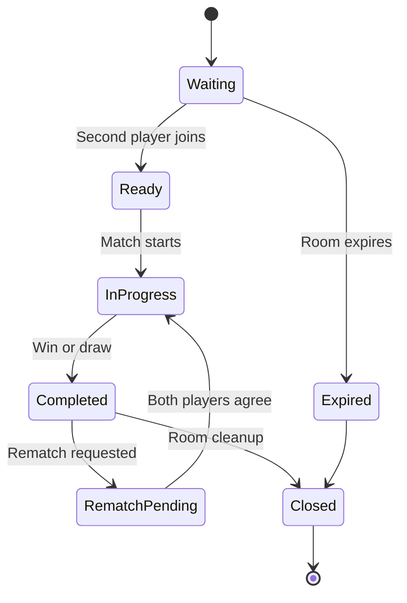

### Acceptance criteria

-   A room creator receives a valid room code.
-   A second player can join with that code.
-   The room cannot accept a third player.
-   X and O assignments are stable.
-   Invalid room operations do not mutate room state.
-   Room tests pass.

------------------------------------------------------------------------

## Phase 9 --- SignalR Real-Time Multiplayer

### Objective

Connect two browsers to the same authoritative online match.

### Agent tasks

1.  Implement `GameHub`.
2.  Map the hub to `/gameHub`.
3.  Define hub methods for:
    -   Create room.
    -   Join room.
    -   Make move.
    -   Request rematch.
    -   Leave room, if supported.
4.  Associate connections with server-side player identities and room
    membership.
5.  Validate room membership and turn ownership on every action.
6.  Route state changes through Application use cases.
7.  Broadcast updated game state only to the relevant room group.
8.  Broadcast room-ready, move-accepted, game-over, rematch, and
    player-disconnected events.
9.  Return controlled error messages for rejected actions.
10. Handle duplicate messages and simultaneous move attempts safely.
11. Keep the hub thin; do not put game rules or room-store
    implementation inside it.

### Online move sequence

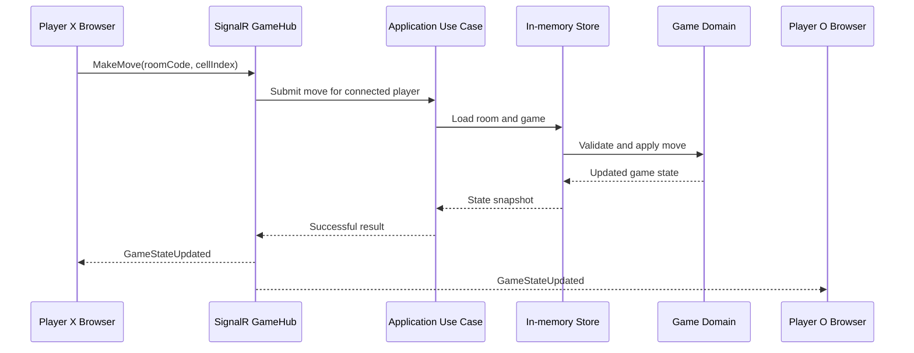

### Acceptance criteria

-   Two browsers can join the same room.
-   Both receive the same authoritative game state.
-   Only the correct player can make the current move.
-   Invalid moves are rejected and not broadcast as accepted moves.
-   A third connection cannot take a player slot.
-   Simultaneous moves cannot both consume the same turn.
-   SignalR integration tests pass.

------------------------------------------------------------------------

## Phase 10 --- Disconnect, Reconnection, and Rematch

### Objective

Support temporary network interruptions and controlled match
continuation.

### Agent tasks

1.  Detect player disconnection.
2.  Mark the player as disconnected without immediately deleting the
    room.
3.  Start the PRD-defined 30-second reconnection window.
4.  Generate and validate a secure reconnect token or equivalent
    server-side mechanism.
5.  Bind the reconnect attempt to the original player slot and room.
6.  Reject expired, reused, or invalid reconnect credentials.
7.  Restore the player connection and send the latest authoritative
    state.
8.  Define and implement the PRD's timeout outcome, such as forfeiture,
    if specified.
9.  Ensure timeout processing can complete a match only once.
10. Implement rematch requests from both players.
11. Reset the game only after both players agree.
12. Cancel pending timeout/cleanup work when the player reconnects or
    the room is closed.

### Reconnection flow

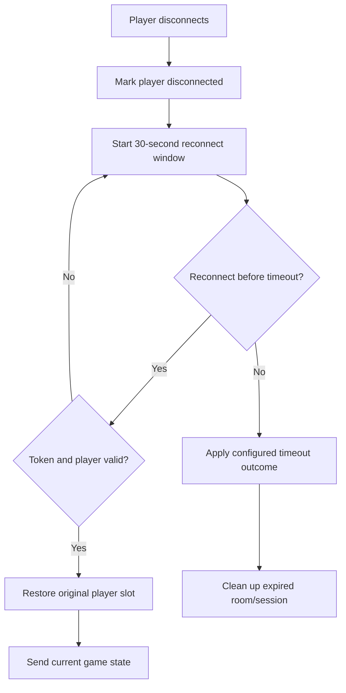

### Acceptance criteria

-   A player can reconnect within 30 seconds.
-   Reconnected players return to the same slot and see the current
    board.
-   Invalid or expired reconnect attempts are rejected.
-   A timeout cannot finalize the same match more than once.
-   Rematch requires both players.
-   Reconnection and rematch tests pass.

------------------------------------------------------------------------

## Phase 11 --- Frontend Completion and Accessibility

### Objective

Polish all game modes into a consistent, responsive browser experience.

### Agent tasks

1.  Complete home and mode-selection pages.
2.  Complete local, AI, and online game pages.
3.  Add clear turn indicators and game status.
4.  Add room code and invitation-link display.
5.  Add connection and reconnection status.
6.  Add win, draw, invalid move, room full, and opponent-left messages.
7.  Add loading/disabled states while actions are pending.
8.  Ensure the board is usable on mobile and desktop.
9.  Add keyboard focus and accessible labels for cells and controls.
10. Prevent repeated clicks from submitting duplicate actions.
11. Avoid putting secrets or authority decisions in browser JavaScript.

### Acceptance criteria

-   All three modes have a consistent visual language.
-   Responsive layout works on common mobile and desktop widths.
-   Controls are keyboard-accessible.
-   The user receives clear feedback for success and failure.
-   UI state is driven by server/application state where applicable.

------------------------------------------------------------------------

## Phase 12 --- Logging, Error Handling, and Security Review

### Objective

Make failures diagnosable while protecting the application and players.

### Agent tasks

1.  Use `ILogger<T>` in controllers, hubs, application services, and
    infrastructure services where useful. and serilig for whole project log find
2.  Log important events:
    -   Game created.
    -   Room created/joined.
    -   Move accepted/rejected.
    -   Game completed.
    -   Player disconnected/reconnected.
    -   Room expired.
    -   Unexpected exceptions.
3.  Use structured properties such as `GameId`, `RoomCode`, and
    operation names.
4.  Do not log secrets, full reconnect tokens, or unnecessary personal
    data.
5.  Configure a global exception-handling strategy.
6.  Return safe client errors.
7.  Validate all inputs on the server.
8.  Apply appropriate rate limits to room creation and repeated invalid
    requests where practical.
9.  Protect state-changing HTTP endpoints against CSRF where cookie
    authentication is used.
10. Verify production HTTPS and secure cookie settings if authentication
    is introduced.
11. Review SignalR origin and authentication configuration.
12. Ensure client-provided player symbols and game results are ignored.

### Error handling flow

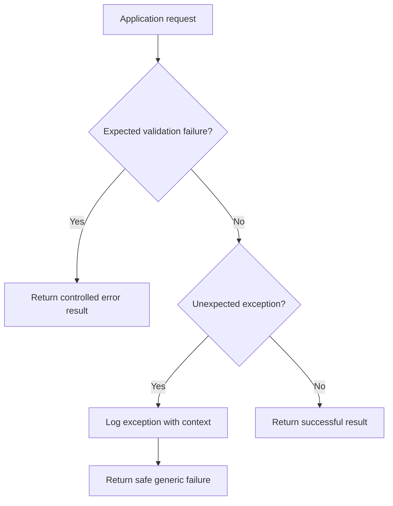

### Acceptance criteria

-   No stack traces or internal exception details reach the browser.
-   Rejected actions do not mutate game state.
-   Server-side validation is enforced for every online action.
-   Logs are useful and do not contain secrets.
-   Security review findings are fixed or explicitly documented.

------------------------------------------------------------------------

## Phase 13 --- Automated and End-to-End Testing

### Objective

Verify the complete product, not only isolated methods.

### Agent tasks

1.  Run all Domain unit tests.
2.  Run all Application unit tests.
3.  Run AI tests.
4.  Run in-memory store and concurrency tests.
5.  Run room-management tests.
6.  Run SignalR integration tests.
7.  Test local two-player gameplay in a browser.
8.  Test AI gameplay in a browser.
9.  Test two independent browser clients in an online room.
10. Test simultaneous move attempts.
11. Test disconnect and reconnect within 30 seconds.
12. Test reconnect after expiry.
13. Test rematch agreement and rejection.
14. Test mobile viewport and keyboard interactions.
15. Run a Release build.
16. Fix regressions and rerun the relevant test suite.

### Required scenarios

  -----------------------------------------------------------------------
  Area                    Scenario                Expected result
  ----------------------- ----------------------- -----------------------
  Domain                  X makes first move      Accepted

  Domain                  O moves before X        Rejected

  Domain                  Occupied cell selected  Rejected

  Domain                  Three in a row          Winner detected

  Domain                  Full board without      Draw detected
                          winner                  

  Domain                  Move after completion   Rejected

  AI                      Immediate AI win        AI takes winning cell
                          available               

  AI                      Human has immediate     AI blocks it
                          winning threat          

  Room                    Third player joins      Rejected

  Online                  Wrong player submits    Rejected
                          move                    

  Online                  Two simultaneous moves  At most one accepted
                                                  for the turn

  Reconnect               Player returns within   Original slot restored
                          30 seconds              

  Reconnect               Player returns after    Rejected or handled by
                          expiry                  defined timeout policy

  Rematch                 Only one player         Board is not reset
                          requests                

  Rematch                 Both players request    New match begins
  -----------------------------------------------------------------------

### Acceptance criteria

-   All automated tests pass.
-   Release build succeeds.
-   Critical manual scenarios pass.
-   Any unsupported test is reported honestly with the reason.

------------------------------------------------------------------------

## Phase 14 --- Deployment Preparation for Monster ASP.NET

### Objective

Prepare and verify the application for the intended hosting environment
without assuming unsupported hosting capabilities.

### Agent tasks

1.  Inspect the Monster ASP.NET plan and deployment requirements
    available to the project.
2.  Verify supported .NET runtime version.
3.  Verify WebSocket support for SignalR.
4.  Verify HTTPS and application routing.
5.  Configure production settings without committing secrets.
6.  Configure logging for the hosting environment.
7.  Ensure the application handles startup and shutdown cleanly.
8.  Verify that in-memory state is not assumed to survive restarts.
9.  Publish the application locally and run a smoke test.
10. Document deployment steps and hosting limitations.
11. Do not deploy to a live account unless explicitly authorized.

### Important in-memory limitation

Because the PRD requires in-memory state:

-   Application restart loses active rooms and games.
-   Application-pool recycle loses active matches.
-   Multiple application instances do not share the same rooms.
-   Reconnection cannot recover a game after its process-local state has
    been lost.

The agent must verify whether the selected Monster ASP.NET plan supports
the required SignalR WebSocket behavior. If the hosting plan cannot
support it, report the limitation rather than claiming online
multiplayer is production-ready.

### Acceptance criteria

-   Release publish succeeds.
-   Published application passes a local smoke test.
-   SignalR hosting requirements are documented and verified where
    access permits.
-   No secrets are committed.
-   Live deployment is not performed without authorization.

------------------------------------------------------------------------

## Phase 15 --- Final Documentation and Handover

### Objective

Leave the repository in a maintainable state with accurate instructions.

### Agent tasks

1.  Update `README.md`.
2.  Document prerequisites and how to run the application.
3.  Document all three game modes.
4.  Document the architecture and dependency direction.
5.  Document SignalR endpoint and event names.
6.  Document in-memory storage and restart limitations.
7.  Document configuration and logging.
8.  Document how to run tests.
9.  Document deployment prerequisites and limitations.
10. Remove temporary debugging code and unused files.
11. Check that no secrets, local-only files, or generated build
    artifacts were added to source control.
12. Provide a final implementation report with completed phases,
    test/build results, known limitations, and any remaining blockers.

### Acceptance criteria

-   A new developer can run the project using the README.
-   Documentation matches the implementation.
-   No feature is described as complete unless verified.
-   Remaining limitations are clearly stated.

------------------------------------------------------------------------

# 6. Overall Implementation Dependency Map

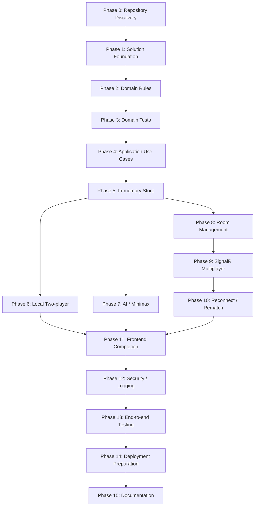

# 7. Agent Execution Protocol

For every phase, the agent must follow this cycle:

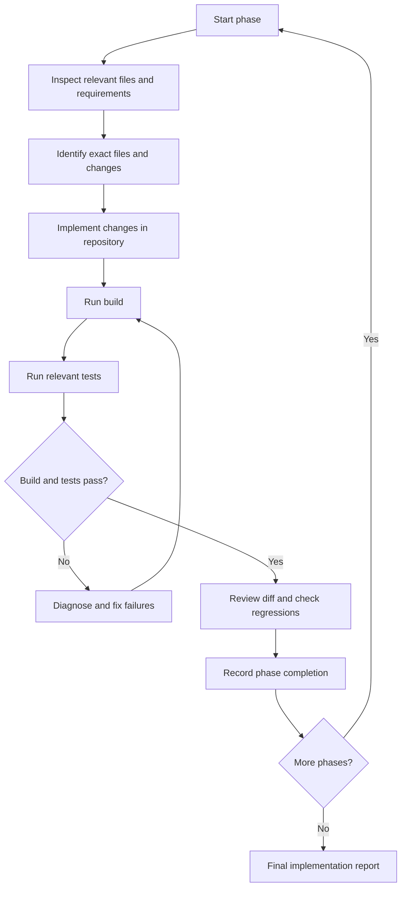

### Required phase report

At the end of each phase, report:

-   **Phase:** Number and name.
-   **Implemented:** Files and behavior added or changed.
-   **Verification:** Commands executed and their results.
-   **Tests:** Tests added, passed, failed, or not run.
-   **Issues:** Any unresolved issue and why it remains.
-   **Next phase:** The next phase that can safely begin.

Do not report a phase as complete if its acceptance criteria are not
met.

## 8. Definition of Done

The project is complete when:

-   Local two-player mode works.
-   Player-versus-AI mode works using Minimax.
-   Online multiplayer supports room creation and joining.
-   SignalR broadcasts authoritative game-state updates.
-   The server validates player identity, turn ownership, and every
    online move.
-   Win, draw, restart, and rematch behavior work.
-   The 30-second reconnection policy is implemented and tested.
-   In-memory state is thread-safe for concurrent operations.
-   No database dependency has been introduced.
-   Logging and safe error handling are configured.
-   Automated tests and Release build pass.
-   Deployment requirements and in-memory limitations are documented.
-   README and architecture documentation reflect the actual
    implementation.

------------------------------------------------------------------------

# 9. Final Instruction to the Coding Agent

**Work autonomously inside the existing Tic Tac Toe repository. Start
with Phase 0 and continue sequentially through the phases. Do not stop
after producing a plan or sample code. Create and modify the actual
project files, run the required commands, test the implementation, fix
failures, and keep the documentation updated.**

Do not ask the user to perform work that the agent can do. Do not invent
completed results. If a genuine blocker requires user input, explain the
exact blocker, what has already been completed, and the smallest action
needed to unblock the work. Resume from the blocked phase once the
required input is available.
