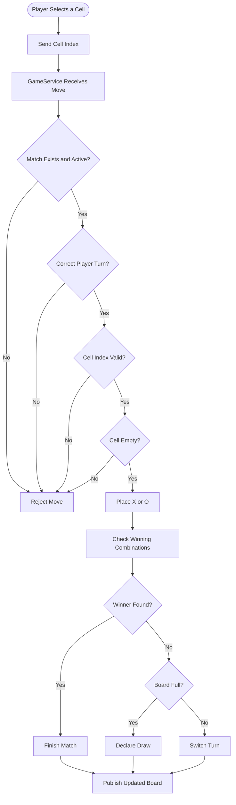
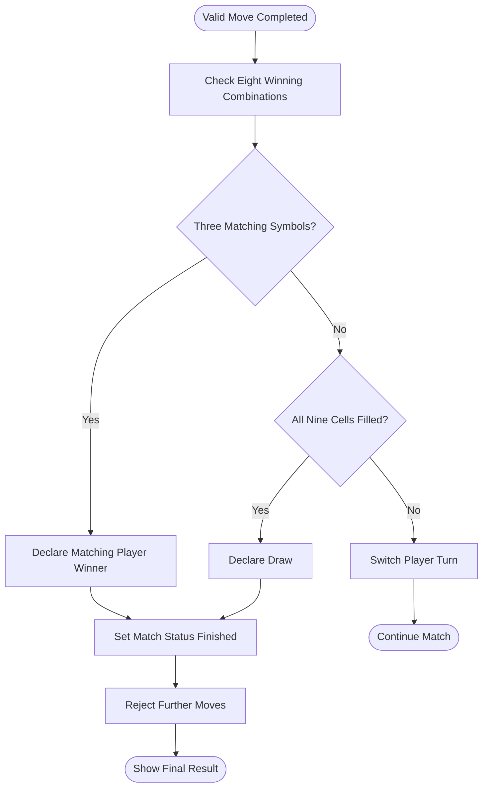
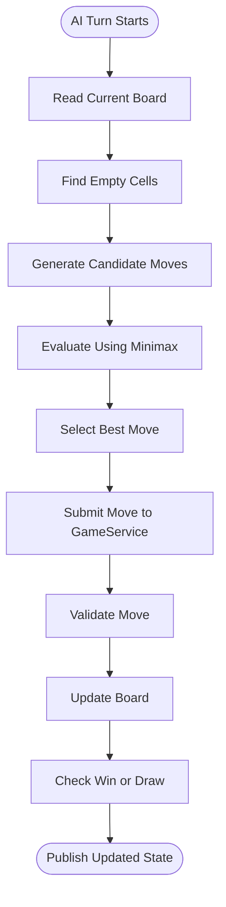
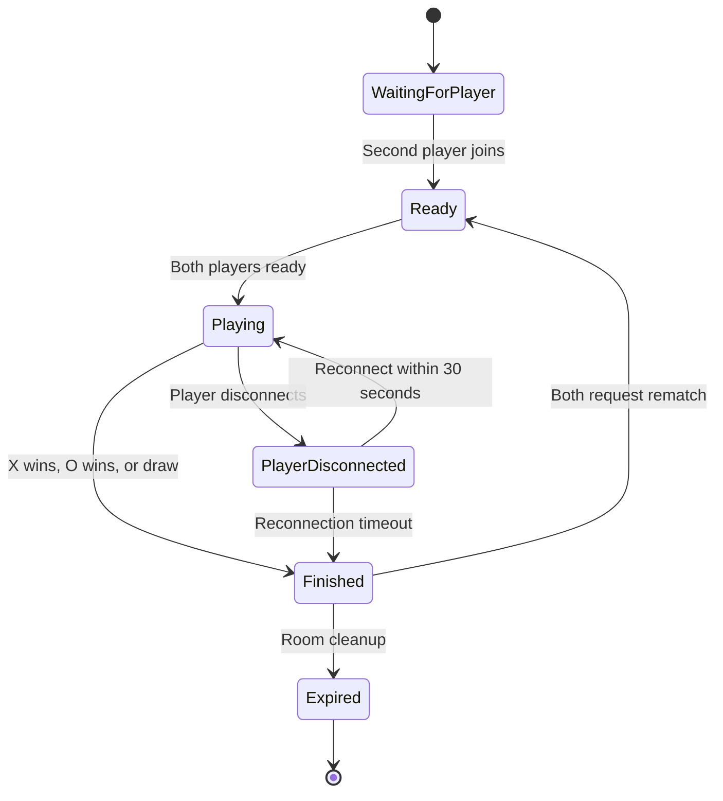
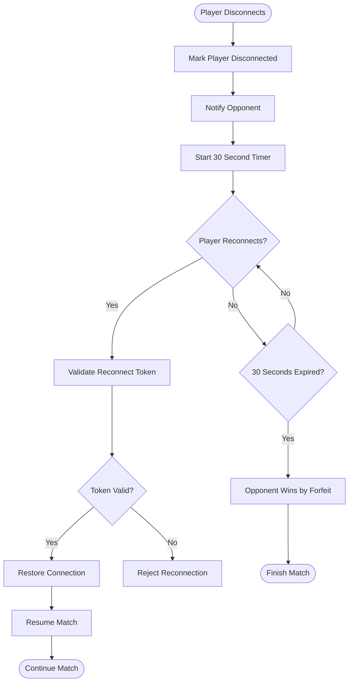

# Tic Tac Toe — Product Requirement Document (PRD)

**Project Name:** Tic Tac Toe  
**Document Type:** Product Requirement Document  
**Version:** 1.0  
**Backend:** ASP.NET Core MVC  
**Programming Language:** C#  
**Frontend:** HTML, CSS, JavaScript  
**Real-Time Communication:** ASP.NET Core SignalR  
**Database:** Not Required  
**Storage:** In-memory  
**Deployment:** Monster ASP.NET  

---

# 1. Introduction

## 1.1 Purpose

This document describes the product requirement of the Tic Tac Toe browser game.

It defines:

- Project structure.
- Layer responsibilities.
- Game engine architecture.
- Game rules and validation.
- Turn management.
- Win and draw detection.
- AI architecture.
- Multiplayer room management.
- SignalR communication.
- Reconnection mechanism.
- In-memory storage.
- Security.
- Deployment considerations.

The goal is to establish a maintainable technical design before implementation begins.


# 2. Game Rules

## 2.1 Board Design

The game contains nine cells arranged in three rows and three columns.

```text
       1     2     3
    +-----+-----+-----+
 1  |  X  |  O  |  X  |
    +-----+-----+-----+
 2  |  O  |  X  |     |
    +-----+-----+-----+
 3  |     |  O  |  X  |
    +-----+-----+-----+
```

The actual game starts with an empty board.

## 2.2 Rules

1. The board contains nine cells.
2. Player X starts first.
3. Players alternate turns.
4. A player can select only an empty cell.
5. A player cannot play outside their turn.
6. Three matching symbols in a row, column, or diagonal win.
7. If all nine cells are occupied without a winner, the result is a draw.
8. No additional moves are allowed after the match finishes.
9. A rematch starts with an empty board.

## 2.3 Winning Combinations

There are eight winning combinations.

| Combination | Cell indexes |
|---|---|
| Top row | 0, 1, 2 |
| Middle row | 3, 4, 5 |
| Bottom row | 6, 7, 8 |
| Left column | 0, 3, 6 |
| Middle column | 1, 4, 7 |
| Right column | 2, 5, 8 |
| Main diagonal | 0, 4, 8 |
| Reverse diagonal | 2, 4, 6 |

Board indexing:

```text
  0 | 1 | 2
 ---+---+---
  3 | 4 | 5
 ---+---+---
  6 | 7 | 8
```

---


# 3. Core Domain Design

## 3.1 GameSession

Represents one active match.

Responsibilities:

- Maintain the board.
- Track the current player.
- Track game status.
- Store the match result.
- Track the number of moves.
- Maintain the winning combination.

Example:

```csharp
public class GameSession
{
    public Guid Id { get; set; }

    public GameMode Mode { get; set; }

    public Board Board { get; set; } = new();

    public PlayerSymbol CurrentTurn { get; set; }
        = PlayerSymbol.X;

    public GameStatus Status { get; set; }
        = GameStatus.InProgress;

    public GameResult? Result { get; set; }

    public int MoveCount { get; set; }
}
```

## 3.2 Board

The board contains nine cells.

```csharp
public class Board
{
    public PlayerSymbol?[] Cells { get; set; }
        = new PlayerSymbol?[9];
}
```

An empty cell is represented by `null`.

## 3.3 Player

Represents a human or AI player.

Important properties:

- Player ID or validated player slot.
- Display name.
- Player symbol.
- Player type.
- Connection status for online matches.

For online matches, the server must determine the player identity from the validated connection or room membership.

## 3.4 Game Enums

```csharp
public enum PlayerSymbol
{
    X,
    O
}

public enum GameStatus
{
    WaitingForPlayers,
    InProgress,
    Finished
}

public enum GameResult
{
    PlayerXWins,
    PlayerOWins,
    Draw,
    PlayerXWinsByForfeit,
    PlayerOWinsByForfeit
}

public enum GameMode
{
    Local,
    VsAI,
    Online
}
```

---

# 4. Move Validation and Turn Management

## 4.1 Move Request DTO

```csharp
public class MakeMoveRequest
{
    public int CellIndex { get; set; }
}
```

The client sends only the selected cell index.

The server determines the player symbol and validates the request.

The client must not send:

- Official board state.
- Winner information.
- Next player information.
- Trusted player identity.
- Client-calculated game result.

## 4.2 Move Validation

The server must validate:

1. The match exists.
2. The match is active.
3. The player belongs to the match.
4. It is the player's turn.
5. Cell index is between 0 and 8.
6. The selected cell is empty.

If validation fails, reject the move without changing the board.

## 4.3 Move Flowchart



---

# 5 Win and Draw Detection

## 5.1 Winning Combinations

There are eight possible winning combinations.

```csharp
private static readonly int[][] WinningCombinations =
{
    new[] { 0, 1, 2 },
    new[] { 3, 4, 5 },
    new[] { 6, 7, 8 },

    new[] { 0, 3, 6 },
    new[] { 1, 4, 7 },
    new[] { 2, 5, 8 },

    new[] { 0, 4, 8 },
    new[] { 2, 4, 6 }
};
```

## 5.2 Winner Detection

After every valid move:

1. Read all eight winning combinations.
2. Check whether all three cells contain the same non-empty symbol.
3. If a combination matches, that player wins.
4. Store the winning combination for UI highlighting.
5. Mark the match as finished.

## 5.3 Draw Detection

A draw occurs only when:

- No winning combination exists.
- All nine cells are occupied.

## 5.4 Match Result Flowchart



---

# 6. Game Modes

## 6.1 Local Two-Player Mode

Two players use the same browser.

Flow:

1. Player X selects an empty cell.
2. The local game validates the move.
3. The board updates.
4. The game checks for a win or draw.
5. If the game continues, the turn changes to O.
6. The process repeats.

Local mode does not require SignalR or a database.

## 6.2 Single-Player vs AI

The human plays as X and the AI plays as O by default.

### AI Responsibilities

1. Read the current board.
2. Confirm that it is the AI's turn.
3. Find available cells.
4. Generate candidate moves.
5. Evaluate possible outcomes.
6. Select the best move.
7. Submit the move through GameService.
8. Let normal game rules detect a win or draw.

### AI Algorithm: Minimax

The Minimax algorithm explores possible future moves.

- AI tries to maximize its score.
- Human tries to minimize the AI's score.
- AI chooses the move with the best possible outcome.

Suggested scoring:

| Outcome | Score |
|---|---:|
| AI wins | +10 |
| Draw | 0 |
| AI loses | -10 |

Use search depth as an adjustment to prefer faster wins and slower losses.

### AI Flowchart



## 6.3 Online Multiplayer Mode

Two players connect through SignalR.

Features:

- Create a room.
- Generate a room code.
- Share an invitation URL.
- Join an existing room.
- Assign X and O.
- Play in real time.
- Request a rematch.

Each room supports exactly two player slots.

---

# 7. Online Room Management

## 7.1 Room Creation

When a player creates a room:

1. Generate a unique room code.
2. Create a room with one occupied player slot.
3. Assign the creator as X.
4. Store the room in memory.
5. Return the room code and invitation URL.

The second player joins as O.

## 7.2 Room Lifecycle



## 7.3 RoomService Responsibilities

- Generate room codes.
- Create rooms.
- Join rooms.
- Validate room capacity.
- Assign player slots.
- Start matches.
- Manage room lifecycle.
- Coordinate room cleanup.

---


# 8. Disconnect and Reconnection

## 8.1 Reconnection Rules

When a player disconnects:

1. Detect the disconnected SignalR connection.
2. Mark the player as disconnected.
3. Notify the opponent.
4. Start a 30-second reconnection deadline.
5. Preserve the current board state.
6. Allow the original player to reconnect using a temporary token.
7. Resume the match if reconnection succeeds.
8. Declare the connected opponent the winner if the deadline expires.

## 8.2 Reconnection Flowchart



## 8.3 Reconnection Token

The server should generate a cryptographically random token.

Requirements:

- Temporary.
- Private to the player.
- Stored in browser session storage.
- Validated on the server.
- Associated with a specific room and player slot.
- Invalidated after match completion.

The room code must not act as a reconnect token.

---


# 9. Concurrency and Game State Protection

Multiplayer requests may arrive simultaneously.

Examples:

- Both players submit moves at nearly the same time.
- A player disconnects while a move is being processed.
- A reconnect request arrives while the timeout is executing.
- Both players request a rematch simultaneously.

Recommended approach:

- Use `ConcurrentDictionary` for room and session lookup.
- Use a per-game synchronization mechanism such as `SemaphoreSlim`.
- Validate player identity and turn ownership inside the protected operation.
- Ensure a move is applied only once.
- Ensure match completion and reconnection timeout are processed only once.

Never assume that `ConcurrentDictionary` alone makes all operations on a game session thread-safe.

---


## Hosting Risk

If Monster ASP.NET recycles or restarts the application:

- Active games are lost.
- Multiplayer rooms disappear.
- Players must create or join a new room.

Before completing multiplayer implementation, test WebSocket support and application lifecycle behavior on the actual hosting plan.


# 10. Final Engineering Principle

**One Shared Game Rules Engine. Three Game Modes. Nine Cells. Eight Winning Combinations. Minimax AI. Server-Validated Online Moves. Zero Database Dependency.**